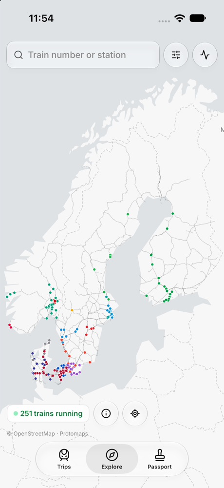
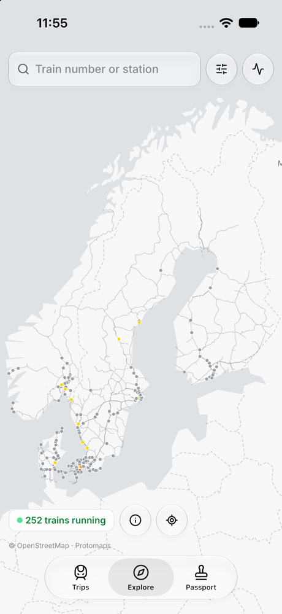
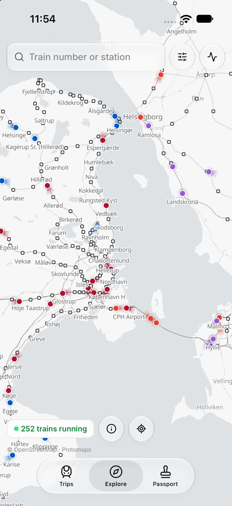
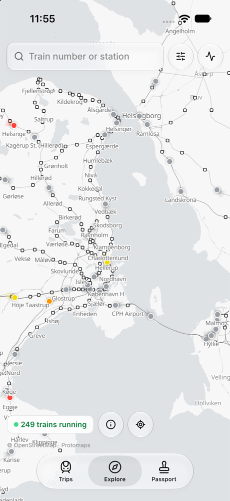

# Explore: train dot colours, A vs B

The same moment and the same views, 2026-11-14 23:55 (live data, iPhone 17 Pro simulator).

| | A: operator colours (today) | B: late only (designer) |
|---|---|---|
| Whole Nordics |  |  |
| Öresund (DSB's red) |  |  |

- **A** is each train in its operator's brand colour. DSB is red, so Denmark reads as a disruption, and red also means very late.
- **B** has neutral grey dots. A train turns yellow, amber or red only when it runs 6+ min late, so trouble stands out and nothing else claims a status colour.

Either way, both stay choices in Explore's filters (Colour by: Operator · Kind · Delay · Country · Late), and your own trains keep their yellow halo. The default for a new phone is one line: `Look.mapDots` in `ClackDesign/Look.swift`.
